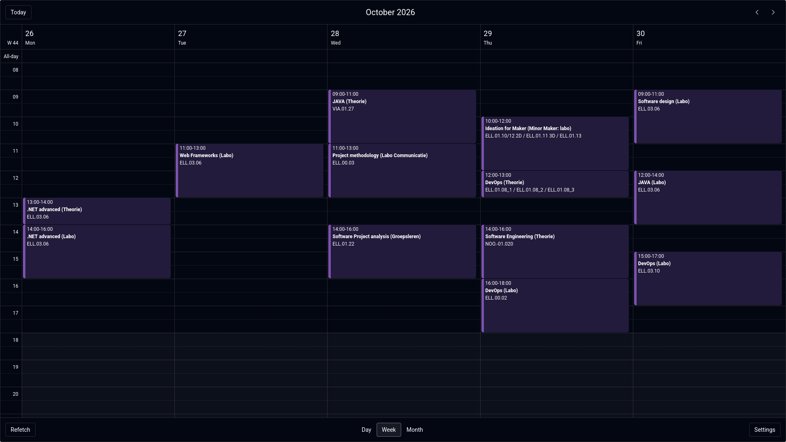
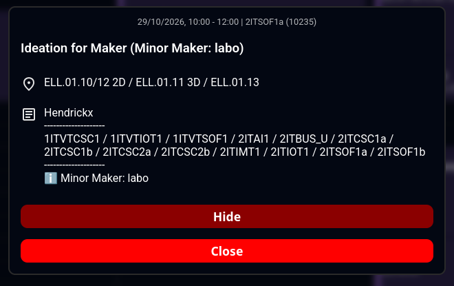
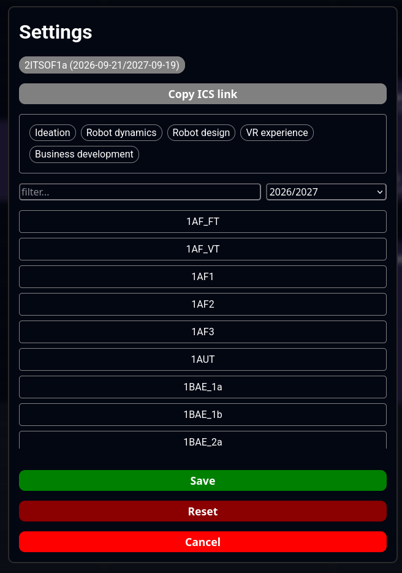
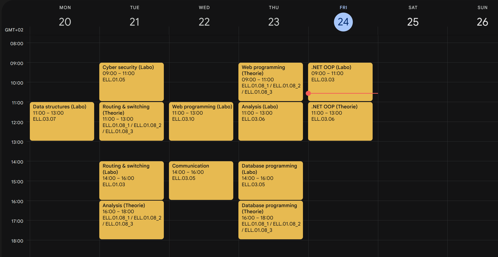
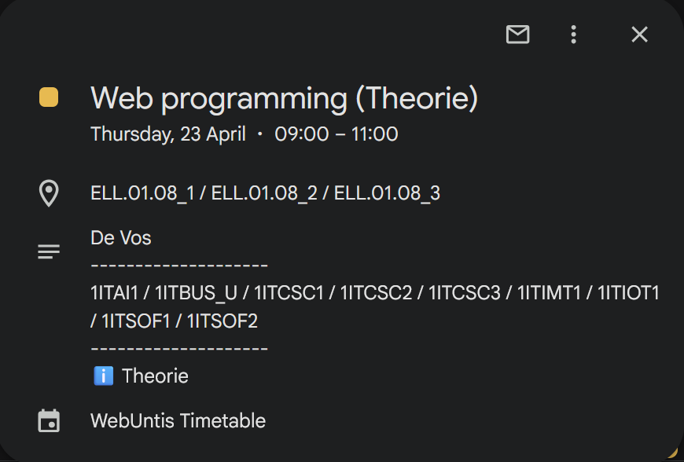

# [ap.webuntis.viovyx.com](https://ap.webuntis.viovyx.com/)

Easy to use .ics generator for importing your Webuntis calendar into your own calendar app.

> [!IMPORTANT]
> The client side recently got an update which changed the ics link endpoint to `/api/calendar`!
>
> There currently is a rewrite rule so that the old path `/calendar` still works, but there is no guarantee this will stay.
>
> **Please update your ics sync link in your calendar clients to `/api/calendar`**

## Usage

### Using the built in calendar

1. Go to the public url above
2. On first launch you will be presented with the list of available classes.
3. Select the classes that you want to view in your calendar and click `save`.
4. It is possible to hide courses that you don't want to see by opening said course and clicking `hide` and confirming the action.
    1. To show the courses again, go to settings in the bottom right corner
    2. Select the class of which you have hidden a course.
    3. Click on the course you want to show again and confirm the action.

### Syncing with your own calendar client

1. Open the settings in the bottom right corner.
2. Make sure the class you want the sync url for is already selected and listed at the top.
3. Click on that class so the copy button is shown.
    1. This view also lists the courses you have hidden.
4. Choose `Copy ICS link`
5. Import the link in your calendar app of choice

This will sync with WebUntis whenever your client syncs the url. It will also exclude the courses you have hidden.

### Tested 3rd party clients

| Client                                                         | Comment                                                     |
| -------------------------------------------------------------- | ----------------------------------------------------------- |
| [Google calendar](https://calendar.google.com)                 | Very inconsistend syncing, no force sync. Widely available. |
| [Nextcloud calendar](https://apps.nextcloud.com/apps/calendar) | Inconsistend syncing, no force sync. Only on web.           |
| [ICSx⁵](https://icsx5.bitfire.at/)                             | Syncs consistently, force sync option. Only on Android.     |

Theoretically this should work in any calendar client that supports importing from url and some might have better results, these are just the ones I've tested myself with my experience.

## Examples

### Built in calendar

#### Week overview:

#### Detailed info view:

#### Settings view:

### Google calendar

#### Week overview:

#### Detailed info view:

## Disclaimers

There is a built in cache that clears every 15min to prevent hitting a possible rate limit from WebUntis.

Made to work for [AP Hogeschool WebUntis](https://ap.webuntis.com/)

> [!NOTE]
> No AI was used for writing code in this project. I made this as a way to learn and improve my own skills.
>
> Some snippits of code from guides and forums were used and modified along the way by myself.

## Issues

If you run into a bug or issue (that is not related to the [the disclaimers](#disclaimers)), feel free to contact me on discord: [@viovyx](https://discord.com/users/431093546561568779).
